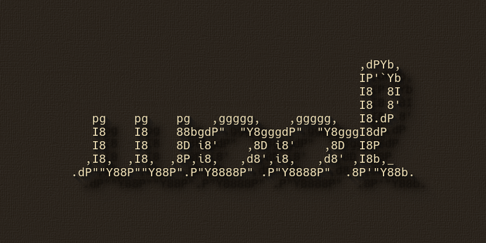
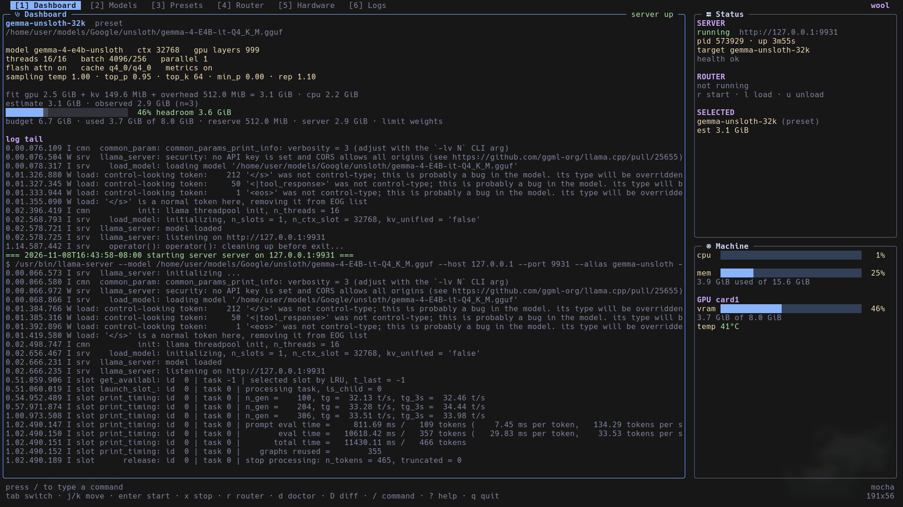

# wool

`wool` is a terminal UI and CLI for running [`llama-server`](https://github.com/ggml-org/llama.cpp) on a Linux workstation. It is a single control surface for standalone launches and llama.cpp router mode: every server runs detached, survives the UI, and can be reattached later.

<p align="center">
  
</p>

- **Single-server mode** — launch one preset or model, detached, then inspect logs and status from a later invocation.
- **Router mode** — run `llama-server` in router mode with a generated `models.ini`, then load, unload, and inspect models through the router API.

<p align="center">
  
</p>

## Features

- **Detached servers by default.** `run`, `start`, and router launches use `setsid`; quitting the TUI never stops inference. State is stored as JSON and processes are validated by PID start tick before they are signalled.
- **One TOML source of truth.** Models, presets, launch options, sampling, router settings, and themes all live in `config.toml`. There is no legacy `presets.conf` importer.
- **Effective-config diff.** `wool config diff TARGET` and the TUI `D` overlay show only the launch options that differ from the model or defaults layer, with the source of each side.
- **Full router control.** Start/stop the router, list models, load/unload, reload presets, and read per-model stats and slots.
- **VRAM-fit estimates.** Reads GGUF metadata and the tensor table, models llama.cpp's tensor placement, Gemma-style sliding-window/shared KV, hybrid attention (Qwen3.5/Qwen3-Next), per-layer KV heads, and quantized KV cache types. The UI shows `weights + KV + overhead`, the budget after reserve and other GPU usage, headroom and the limiting term.
- **Auto-fit recommendations.** `wool fit TARGET` binary-searches the largest context that fits the budget, capped at the model's native context. When the requested settings cannot hold a useful context it ranks fallbacks: lower KV cache precision first, then CPU offload (using `n_cpu_moe` for MoE models). Every recommendation is within budget and includes weights, KV, overhead, headroom, the limiting term and the changes it makes. `--save-preset NAME` writes the result as a new preset.
- **Benchmarks and history.** `wool bench TARGET` starts an ephemeral server, warms up, and records prompt and generation throughput over repeated runs with median/min/max and peak VRAM. It can attach to a matching managed server or any `--url`, and optionally drive `llama-bench`. `wool bench history` and the Bench tab show past runs, trends and a two-run comparison. `wool bench compare A B` runs two targets interleaved and reports the median, spread and percentage delta.
- **Observed vs. estimate.** After a launch, `wool` records used VRAM at 5s and 15s and shows it next to the estimate with a sample count. With at least three matching samples, the dashboard and doctor also show a median correction, clamped to 0.5–2.0; the raw estimate is always kept. Samples expire when the model file, GPU, driver or `llama-server` version changes.
- **Live inference panel.** The Inference tab shows prompt and generation tokens/s, request counts, slot occupancy and KV-cache fill, and speculative-decoding acceptance, with sparklines, sourced from the server's `/metrics` and `/slots`. It follows the standalone server or the selected router model, and `wool stats [MODEL] [--json]` prints the same numbers for scripts.
- **Structured request log.** The Logs tab parses the request-completion lines `llama-server` already writes into a best-effort table of timestamp, model, prompt/generated tokens, prompt/generation time, cache hits and status. `v` toggles the raw log, `m` filters by model, and `f` pauses or follows. Unknown formats fall back to the raw log with a note, and `wool logs --json` prints the same rows for scripts.
- **Configurable alerts.** Opt-in rules warn about high GPU temperature or VRAM, failed health checks, OOM and failed model loads in the log tail, and restart loops. Alerts appear in the Status panel, are deduplicated per rule with a cooldown, and can optionally be sent through `notify-send` or a JSON webhook. `wool alerts [--json]` runs the same check once for scripts.
- **Crash detection and restart.** If a recorded server dies while wool is attached, the dashboard shows a crash card with the inferred reason (OOM, port conflict, model-load failure, signal or unknown) and the relevant log lines. `S` or `wool restart` relaunches the recorded argv, and an opt-in `[server] restart` policy can retry automatically with exponential backoff, a sliding attempt window and a cap. A clean `wool stop` never triggers a restart. `wool supervise TARGET` runs the standalone server under a detached supervisor that keeps retrying even after the TUI or CLI exits.
- **Hardware telemetry.** CPU, RAM, AMD `amdgpu` VRAM, temperature, power, fan, and sparklines, with no extra daemon required.
- **Preset and model editing.** Edit resolved launch options in the TUI; changes are written back to TOML with comments and ordering preserved. Changing `ctx`, cache type, `gpu_layers` or `n_cpu_moe` previews the new estimate without saving.
- **Eight tabs, themes, commands.** Dashboard, Models, Presets, Router, Inference, Hardware, Logs, Bench; built-in and custom themes; slash commands and completion.
- **Doctor.** Checks the binary, model files, hardware, and VRAM fit before you launch.

## Requirements

- Linux (AMD `amdgpu` telemetry is implemented first; the telemetry layer is pluggable).
- Go 1.27+ to build.
- `llama-server` from llama.cpp in `PATH`, or set `app.llama_server` in the config.
- GGUF model files. The example config points at `~/models`.

## Build and install

```sh
go build -o wool ./cmd/wool
install -m 0755 wool ~/.local/bin/wool
```

For a quick development build:

```sh
go run ./cmd/wool --config config.example.toml
```

## Quick start

```sh
# Create ~/.config/wool/config.toml from the example.
wool config init

# Edit model paths, then verify the setup.
$EDITOR ~/.config/wool/config.toml
wool doctor

# Open the TUI.
wool

# Or drive a launch directly.
wool run qwen-cyber-32k
wool status --json
wool logs server -n 20
wool stop server
```

`wool run TARGET` uses a preset name or a model ID. The process is started detached; `--no-wait` returns immediately, `--dry-run` prints the `llama-server` argv, and `--restart` replaces an existing standalone server. `--smoke` sends one tiny prompt after health to prove the preset can generate; `--strict` makes a failed check stop the server and exit non-zero. The check is off by default and can be enabled persistently with `[server] smoke_test = true`.

`wool supervise TARGET` starts the same launch under a detached supervisor. It accepts `--restart`, `--port N` and `--no-wait`. The supervisor always retries unexpected exits within `restart_max`, `restart_window` and `restart_backoff`; `[server] restart` is not consulted because supervision is explicit. Set `restart_max = 0` to give up after the first exit. `wool stop` still performs a clean stop and never triggers a restart. Use `wool status` to see `supervised` or `orphaned` instances.

## CLI

```text
wool [--config PATH]                 open the TUI
wool doctor [--json]                 check binary, models and VRAM fit
wool fit TARGET [options]            recommend settings that fit a VRAM budget
wool bench TARGET [options]          benchmark prompt and generation throughput
wool bench --url URL --model ID      benchmark an already-running server
wool bench history [TARGET]          show recorded benchmark runs
wool bench compare A B [options]     interleaved A/B benchmark comparison
wool list [--json]                   list models and presets
wool run TARGET [options]            start a model or preset detached
wool supervise [options] TARGET      run a target under a detached supervisor
wool restart [server|router] [--no-wait]  relaunch the recorded instance
wool stop [server|router|all]        stop detached servers
wool status [name] [--json]          show detached server state
wool stats [MODEL] [--json]          live prompt/gen t/s, requests, slots
wool logs [name] [-n N] [-f] [--json] show a server log, or parsed requests
wool alerts [--json]                 evaluate alert rules against current state
wool router [start|stop|status|models|load ID|unload ID|reload|ini]
wool config path                     print the config path
wool config init [--force] [PATH]    write a sample config
wool config explain TARGET [--json]  show each value and where it came from
wool config diff TARGET [--against defaults|model] [--json]
wool version
```

Router start accepts `--dry-run`, `--restart`, `--port N`, and `--no-wait`.

`wool stats [MODEL]` scrapes `/metrics` and `/slots` twice, `--window D`
apart (default 1s), and prints window and lifetime prompt/generation
throughput, request counts, slot occupancy and KV fill, plus speculative
acceptance when in use. It targets an explicit router MODEL, else the
standalone server, else the router's first loaded model. `--json` prints the
stable versioned snapshot for scripts. A server started with `metrics = false`
makes the command fail with the reason instead of printing zeros.

`wool fit TARGET` accepts a preset name or model ID plus `--vram SIZE`,
`--cache-type TYPE`, `--gpu-layers N`, `--n-cpu-moe N`, `--save-preset NAME`,
`--force`, `--calibrated` and `--json`. It prints a ranked recommendation and
alternatives, the estimate breakdown, headroom, the limiting term and any
changes from the requested settings. `--vram 7G` means a 7 GiB card: the solver
subtracts `router.memory_margin_mib` and ignores live usage from other
processes, so output is deterministic. Without `--vram` it uses the live GPU
budget and excludes a running standalone server's own allocation.

`--calibrated` attaches the median observed/estimate correction for each
recommendation's launch shape and labels the output as calibrated. The raw
estimate and solver verdict stay visible; the corrected value and headroom are
additional. Below three matching samples no correction is applied.

`--save-preset NAME` writes the primary recommendation as `[presets.NAME]`
with the model reference plus `ctx`, `gpu_layers`, `n_cpu_moe`,
`cache_type_k` and `cache_type_v`. The rest of the TOML file, including
comments and other presets, is preserved. An existing name is only replaced
with `--force`; `--force` without `--save-preset` is rejected.

```sh
wool fit qwen-cyber-32k --vram 8G
wool fit lfm25-24b-a2b --vram 8G --json
wool fit lfm3-1-7b --vram 8G --cache-type q8_0 --gpu-layers 32
wool fit lfm3-1-7b --vram 8G --save-preset lfm-fitted
wool fit lfm3-1-7b --vram 8G --save-preset lfm-fitted --force
```

The minimum useful context is 2048 tokens and recommendations snap to a
256-token grid. If the requested settings cannot fit 2048 tokens, the solver
tries lower KV cache precision, then CPU offload, then both. For MoE models it
prefers `n_cpu_moe`; all-CPU placement is a last resort. If no combination
fits, the command exits with an actionable error instead of returning an
over-budget configuration. Recommendations are advisory: use `F` in the editor
to apply one to the draft, then `ctrl+s` to save the target's options, or `p`
in the fit overlay to save it as a new preset.

`wool bench TARGET` accepts a preset name or model ID plus `--runs N`
(default 3), `--pp N` (prompt tokens, default 512), `--tg N` (generated
tokens, default 128), `--engine server|llama-bench`, `--no-warmup` and
`--json`. The default engine starts an ephemeral `llama-server` on a free port,
waits for health, warms up, and sends the same temperature-0/seed-42 prompt for
each run. If a managed `server` is already running with the same model and
launch shape, it attaches instead of starting another. `--url URL --model ID`
benchmarks an existing server without starting one. The ephemeral child is
stopped on completion, error or `Ctrl-C`.

Throughput prefers the completion response's `timings`, falls back to
`/metrics` counter deltas, and finally to wall time; each raw run records which
source was used. The command prints the median, minimum and maximum and appends
one record with `kind: "bench"` to the measurement store. `--json` prints that
record, including every raw run. The optional `llama-bench` engine uses the
binary next to the configured `llama-server` or on `PATH`; the default engine
does not need it.

```sh
wool bench qwen-cyber-32k
wool bench lfm3-1-7b --runs 5 --pp 1024 --tg 256
wool bench qwen-cyber-32k --engine llama-bench
wool bench --url http://127.0.0.1:8080 --model qwen-cyber-32k --json
```

`wool bench history [TARGET]` reads the same store and prints the newest runs
(default 20) with timestamp, target, prompt and generation tokens/s, VRAM, load
time and config hash. A target may be a preset name or model ID; omit it to show
every benchmark. `--limit N` changes the row count and `--json` prints the
matching records. The store keeps the newest 5000 records: after an append pushes
it over the cap, the oldest lines are dropped and the file is rewritten
atomically. Writers serialize on `runs.jsonl.lock`, so a benchmark in one process
cannot race a rotation in another.

```sh
wool bench history
wool bench history qwen-cyber-32k --limit 10
wool bench history --json
```

`wool bench compare A B` measures two presets or models in the same session.
`--runs N` is the number of rounds per target (default 3), so it performs `2N`
measured completions. Rounds alternate order (`A B B A …`) to reduce thermal
drift, and both targets use the same prompt, seed and generation length. Each
round starts a fresh ephemeral server, so the two models never occupy VRAM
together; each side is stored as its own `kind: "bench"` record. The report shows
the median, relative spread and percentage delta for prompt and generation
throughput, the raw generation runs, and warnings when the spread is above 10%
or the GPU, driver or `llama-server` version changed between sides. `--json`
prints the stable comparison schema (version 1). `--url` and `--model` are not
supported here; compare resolves both targets from the config.

```sh
wool bench compare qwen-cyber-32k qwen-cyber-65k
wool bench compare lfm3-1-7b lfm3-1-7b-q8 --runs 5 --json
```

In the TUI, `B` opens the Bench tab. It shows prompt and generation sparklines
over the filtered runs, a run table, and full details for the selected run.
`space` marks a run, `enter` compares the marked and selected runs, `f` cycles
the target filter, and `D` opens the M1.4 config diff for the selected run's
target. `/bench compare A B` opens the newest recorded run of each target in the
same comparison overlay.

## Live inference

`wool stats [MODEL]` and the Inference tab (`i`, or key `5`) read the server's
`/metrics` and `/slots` every poll interval. Rates are counter deltas over the
server's own busy seconds (`prompt_seconds_total`,
`tokens_predicted_seconds_total`), with wall clock as the fallback, so idle
time between requests is not counted against throughput. The panel shows
prompt and generation tokens/s with sparklines, requests processing/deferred,
slot occupancy with per-slot KV fill bars, and speculative-decoding acceptance
when the model uses it.

The source is the standalone server when it is running, otherwise the
selected router model; `m` on the Inference tab cycles between the two, and
`j`/`k` picks another router model. A counter that decreases means the server
restarted, so the baseline is re-seeded and the panel says so instead of
printing a negative dip. Servers started with `metrics = false` (it defaults
to true) get an explicit "metrics unavailable" message rather than zeros.

```sh
wool stats                     # whichever server is running
wool stats qwen-cyber-32k      # one router model, by ID
wool stats --window 2s --json  # stable snapshot for scripts
```

## Request log

The Logs tab (`L`, or key `7`) defaults to a structured table built from the
request-completion lines `llama-server` writes to its log. A row appears when a
timing block completes, with the time wool first saw it, the model, prompt and
generated tokens, prompt and generation milliseconds, cache hits and status.
Non-2xx `log_server_r` lines become error rows. `v` switches to the raw log,
`m` cycles the model filter, `f` pauses or follows, and `j`/`k` scroll. The
header marks the view `best effort`; the raw log is always one key away.

The table keeps the newest 200 completed requests in memory. It is rebuilt
incrementally as the log grows, and resets when the target changes or the log
is truncated or rotated. Parsing covers the two common `llama-server` layouts
(`n_prompt_tokens` and `task.n_tokens`); progress and unrelated lines are
ignored rather than turned into rows. When no known line has been seen, the
tab shows the raw log with an `unrecognised ... request log` note. Router child
lines are attributed to a model by their `[port]` prefix when the router
reports a matching `--port`; otherwise they are labelled `router`. Standalone
rows use the running preset or model.

```sh
wool logs server --json        # parsed rows, best effort
wool logs router -n 500 --json # parse more of the tail
```

`--json` prints the stable `logsSnapshot` (version 1) with `source`,
`best_effort`, `recognized` and `rows`. `--json` cannot be combined with `-f`.
`-n` bounds how many raw log lines are read before parsing (default 100), so
increase it to capture more history.

## Alerts

Alerts are opt-in. When enabled, the TUI evaluates the rules on every poll and
shows the newest two in the Status panel; the newest 20 are kept in memory.

```toml
[alerts]
enabled = true
temp_c = 90                  # GPU temperature threshold, 0–150
vram_percent = 95            # VRAM usage threshold, 0–100
cooldown = "5m"              # per-rule deduplication window
notify = true                # desktop notification via notify-send
webhook = ""                 # optional JSON POST URL
```

Rules cover GPU temperature, VRAM usage, an unhealthy server or router, OOM or
“out of memory” lines in the log tail, a failed router model load, and a restart
loop (three observed starts within ten minutes). Health checks get a 15-second
grace window after launch, and log rules fingerprint the matching line so a
stale message does not re-fire. Each `rule|subject` pair is emitted at most once
per cooldown.

Notifications are best effort. A missing `notify-send` is ignored, and the
webhook POST has a three-second timeout and runs off the UI goroutine. Webhook
errors never include the URL, so tokens in it are not logged. The status bar
always shows the alert even when optional delivery fails.

```sh
wool alerts           # one-shot text check
wool alerts --json    # stable alertsSnapshot (version 1)
```

`wool alerts` does not send notifications. It prints `no alerts` when nothing
is active and `alerts disabled` when the section is off.

## Configuration

The default config is `~/.config/wool/config.toml` (XDG-aware). `config.example.toml` is a complete, commented starting point.

```toml
[app]
theme = "mocha"              # built-in or a [themes.<name>] custom theme
nerd_fonts = true
model_dirs = ["~/models"]
llama_server = "llama-server"
log_lines = 10000

[server]
host = "127.0.0.1"
port = 8080
auto_port = true
startup_timeout = "120s"
poll_interval = "5s"         # TUI refresh; clamped to 250ms..1m
smoke_test = false           # send one tiny prompt after health
smoke_timeout = "30s"        # bounds the whole smoke request
restart = "never"            # never | on-failure | always; active policies retry unexpected deaths
restart_max = 3              # attempts inside restart_window; 0 disables
restart_window = "10m"
restart_backoff = "2s"       # doubles per attempt, capped at 1m

[defaults]
gpu_layers = 999
threads = 0                  # 0 = nproc
cache_type_k = "q4_0"
cache_type_v = "q4_0"
flash_attn = "on"

[models.qwen3-4b-cyber]
path = "~/models/Qwen3-4B-cybersecurity-heretic.gguf"
alias = "Qwen-Cyber"
ctx = 65536

[presets.qwen-cyber-32k]
model = "qwen3-4b-cyber"
ctx = 32768

[router]
models_max = 1
memory_margin_mib = 512
autoload = false
sleep_idle_seconds = -1
metrics = true

[alerts]
enabled = false              # opt-in
temp_c = 90
vram_percent = 95
cooldown = "5m"
notify = false               # desktop notification via notify-send
webhook = ""                 # optional JSON POST URL
```

Launch options are inherited in this order:

```text
built-in defaults -> [defaults] -> [models.<id>] -> [presets.<name>]
```

Unset keys inherit; explicit zero/false values are preserved. `threads = 0` resolves to `runtime.NumCPU()`, and `threads_batch = 0` follows `threads`.

`wool config explain TARGET` shows every effective launch option with the layer that supplied it (`built-in`, `defaults`, `model` or `preset`). Add `--json` for `value`, `source` and `layer` fields. In the editor, the same source is shown next to each row; `backspace` or `delete` removes that override and falls back to the next layer.

`wool config diff TARGET [--against defaults|model]` shows only the options whose resolved value differs from the comparison layer. A preset defaults to its model, so the result is what the preset actually changes; a model defaults to the defaults layer. `--json` includes the value, source and layer for both `target` and `against`, and `fields` is empty when nothing differs. The TUI `D` key opens the same view for the selected model or preset.

The dashboard and `wool doctor` decompose the estimate into weights, KV cache and overhead, then compare it with the budget for a new server: GPU total minus `router.memory_margin_mib` minus VRAM used by other processes. A running standalone server's own allocation is excluded so a restart is not charged twice. `wool doctor --json` includes the same `estimate`, `budget`, `headroom_bytes` and `limiting_term` fields. While editing, the preview updates as you type; `enter` commits and `esc` discards.

Successful launches also record one observation in `$XDG_STATE_HOME/wool/measurements/runs.jsonl`: a pre-launch VRAM baseline, samples at 5s and 15s after health, and the estimate for that exact launch. The dashboard and doctor show `estimate 6.1 GiB · observed 6.4 GiB (n=3)`; with at least three matching samples they add `corrected 6.4 GiB (n=3, ±8%)`. The observation is a baseline-subtracted delta, not an exact model footprint, and it is recorded even when the baseline is unknown (shown as `observed unknown`). The correction is the median observed/estimate ratio, clamped to 0.5–2.0, and it is display-only unless `wool fit --calibrated` is used. Samples are ignored when the model file, GPU, driver or `llama-server` version changed. A smoke test adds `verified_at` on success plus `smoke_ms` and `smoke_error`; the dashboard shows `✓ verified` or the short failure reason for the newest attempt. `wool bench` appends records with `kind: "bench"` to the same file; they carry the raw runs, throughput summary and peak VRAM, and are ignored by calibration.

### Custom themes

```toml
[themes.dusk]
base = "tokyo"               # built-in or another custom theme

[themes.dusk.colors]
accent = "#ff9e64"
border = "#565f89"
```

Supported color keys: `border`, `accent`, `text`, `dim`, `badge_fg`, `red`, `yellow`, `green`, `cyan`, `blue`, `mauve`, `pink`, `orange`, `teal`. Colors accept `#rgb`, `#rrggbb`, `#rrggbbaa`, or a terminal index `0`–`255`. Use `t` to cycle themes or `/theme <name>` to select one.

## TUI

| Key | Action |
| --- | --- |
| `tab` / `shift+tab` | next / previous tab |
| `1`..`8` | jump to tab |
| `j` / `k`, arrows | move selection or scroll logs |
| `g` / `G` | first / last entry; in logs, tail or follow |
| `enter` | start target, load router model, switch log target, or compare bench runs |
| `s` / `x` | start / stop the standalone server (x dismisses a crash card) |
| `S` | restart the selected target or the crashed server |
| `r` / `R` | start / stop the router |
| `l` / `u` | load / unload the selected router model |
| `i` | focus the Inference panel |
| `m` | cycle the Inference source (server / router model), or the Logs model filter; elsewhere, show router-model stats |
| `v` | toggle the Logs tab between structured requests and the raw log |
| `L` | focus logs |
| `B` | focus the Bench history tab |
| `space` | mark a benchmark run for comparison |
| `f` | toggle log follow, or cycle the Bench target filter |
| `e` | edit the selected preset or model; `backspace`/`delete` resets a row |
| `F` | recommend settings that fit VRAM in the editor |
| `p` | save the selected recommendation as a preset (in the fit overlay; `P` replaces) |
| `d` | run doctor |
| `D` | show the selected config diff, or the Bench run's target diff |
| `t` | cycle theme |
| `ctrl+r` | reload config.toml |
| `/` or `:` | command line |
| `?` | help overlay |
| `q` / `ctrl+c` | quit without stopping servers |

Slash commands include `/start`, `/restart`, `/stop`, `/dismiss`, `/router`, `/load`, `/unload`, `/reload`, `/edit`, `/fit`, `/doctor`, `/theme`, `/tab`, `/bench`, `/logs`, `/help`, and `/quit`.

## Router mode

Router mode writes a deterministic `models.ini` with one section per `[models.*]` entry. `[defaults]` becomes `[*]`, and each model section contains its resolved options. The file is regenerated on router start, `router reload`, and the TUI reload action.

Only router-level options are passed on the command line:

```text
--host H --port P --models-preset models.ini --models-max N
[--models-autoload | --no-models-autoload]
[--sleep-idle-seconds N] [--metrics] [--fit-target MiB]
```

```sh
wool router start
wool router models
wool router load qwen3-4b-cyber
wool router unload qwen3-4b-cyber
wool router reload
wool router stop
```

## Runtime files

```text
~/.local/state/wool/
  servers/server.json       # standalone server state
  servers/router.json       # router state
  logs/server.log
  logs/router.log
  router/models.ini         # generated, do not edit
  measurements/runs.jsonl   # observations and benchmarks, append-only
  measurements/runs.jsonl.lock  # writer lock for safe rotation
```

Logs are tailed from disk with a bounded read, so reattaching is cheap even for large logs. The measurement store keeps the newest 5000 records; older lines are compacted away after an append.

## VRAM estimate

`wool` estimates VRAM from the GGUF key/value block and tensor-info table: each tensor is sized from its type and dimensions, then classified as a block, input, output or repeating tensor. Placement follows llama.cpp: `gpu_layers` counts the output layer, input embeddings always stay in host memory, output tensors follow the output layer, and repeating tensors follow layer 0. `n_cpu_moe` moves expert bytes independently.

The KV cache comes from context, attention heads, cache type and the layer schedule. Hybrid models such as Qwen3.5/Qwen3-Next only keep KV for every `full_attention_interval`-th layer. Sliding-window layers are charged `min(ctx, sliding_window)` with their SWA head widths, while global layers keep the full context; trailing shared-KV layers allocate nothing. Gemma 2/3/3n defaults are applied when the file omits the pattern. A sliding window without a known pattern is charged full context and marked approximate.

For MoE models, `n_cpu_moe = N` keeps the routed-expert tensors (`ffn_*_exps`) of the first `N` layers on the CPU; routers and shared experts stay with their layer. If the tensor table is missing, a quantisation type or tensor name is unsupported, or expert tensors cannot be identified, `wool` falls back to the file-size fraction and marks the estimate approximate. Doctor and the editor preview explain why. A fixed overhead covers compute buffers and allocator slack. The estimate is deliberately conservative and still omits unused MTP tensors and speculative decoding buffers, so it is a fit warning rather than an exact measurement.

`wool fit` inverts that estimate. It searches for the largest context on a 256-token grid that fits the budget, up to the model's native context. The requested settings are tried first; when they cannot hold at least 2048 tokens, the solver steps down through cache precision, CPU offload and finally both. The result is deterministic: the same config, model file and `--vram` value produce the same ranking. Add `--calibrated` to attach the measured correction to each recommendation; the raw estimate and fit verdict remain the primary result. In the editor, `F` opens the picker against the live budget; `enter` applies the selection to the draft, and `ctrl+s` writes only the changed `ctx`, `gpu_layers`, `n_cpu_moe`, `cache_type_k` and `cache_type_v` values. `p` saves the selected recommendation as a new preset without touching the draft; an existing name requires `P` to replace it.

## Project layout

```text
cmd/wool/          CLI parsing, subcommands, TUI entry point
internal/app/      Bubble Tea model, views, actions, editor
internal/config/   TOML schema, merging, path handling, config edits
internal/daemon/   detached process lifecycle, state, ports, logs
internal/llamaserver/ argv/INI generation and HTTP API client
internal/gguf/     GGUF metadata reader and VRAM estimate
internal/fit/      auto-fit solver, fallback ranking and size parsing
internal/measure/  observed VRAM and benchmark JSONL store, launch capture
internal/bench/    server and llama-bench runners, summaries, VRAM sampling, A/B comparison
internal/reqlog/   llama-server request-log parser and bounded row tail
internal/alerts/   alert rules, deduplication and optional notifiers
internal/sysinfo/  /proc and AMD sysfs telemetry
internal/doctor/   readiness checks
internal/theme/    palettes, styles, icons, custom themes
internal/ui/       panel, bar, sparkline and layout helpers
docs/DESIGN.md     architecture and behavior details
docs/roadmap.md    sequenced milestones, priorities and exit criteria
docs/features/     one spec per planned feature, plus the feature index
docs/RELEASING.md  release checklist and tagging steps
.github/workflows/ CI and tagged release automation
```

## Testing

```sh
gofmt -l .
go build ./...
go vet ./...
go test -count=1 ./...
```

Tests cover config parsing/merging/editing, effective-config diffs, GGUF metadata and tensor parsing, hybrid KV and MoE expert-offload estimation, dense/hybrid/MoE auto-fit solving and fallback ranking, measurement storage and capture, benchmark history filtering and store rotation, benchmark runners and `llama-bench` parsing, interleaved A/B comparison and its noise warnings, argv and INI generation, router metrics, alert thresholds, cooldowns, log fingerprints and notifier behaviour, crash classification, restart backoff/window handling, detached supervision and orphan cleanup, daemon lifecycle and PID validation, sysinfo parsing, themes, and TUI rendering at multiple terminal sizes. Benchmark tests use a fake HTTP server and temporary state; alert tests use a fake notifier and an injected clock; restart and supervisor tests use short-lived `/bin/sh` children, and none require `notify-send` or the network.

## Limitations

- Only AMD sysfs telemetry is implemented; NVIDIA/Intel need new backends.
- One standalone server and one router are managed per state directory.
- The editor can reset launch-option overrides, but not `model`, `path`, `alias` or `extra` keys.
- Standalone servers are restarted while a wool process is attached, or under a detached `wool supervise` supervisor. The default in-session policy is `never`, so automatic restarts are opt-in; `wool supervise` is itself opt-in. Router-managed models are supervised by `llama-server` itself. A supervised instance is not a system service; use systemd if you need durable service management.
- VRAM estimates fall back to a file-size approximation, and say so, when tensor metadata, a quantisation type or a tensor name is unsupported, or when a sliding-window layer pattern is unknown. Speculative decoding buffers are not modelled.
- `wool fit` is advisory and inherits the estimator's approximation. It never recommends an over-budget configuration, but the recommendation is a starting point with headroom, not a guarantee.
- `wool fit --save-preset` and the editor's `p` action write a preset from the fit-controlled values only. Replacing an existing preset updates those keys and leaves its other options and comments alone; there is no preset-diff preview before writing.
- Observations and benchmark peak VRAM are system-wide deltas; background GPU work makes them noisy. They are never presented as exact usage, and an arbitrary `--url` server cannot report a VRAM delta.
- Benchmarks are single-stream and short by default. They measure one fixed prompt rather than concurrent load, and prompt length is approximated by repeating a sentence instead of tokenizing.
- A/B comparison warns when spread is above 10%, but that is a coarse guard, not a significance test. Small deltas on a shared machine can still be noise; use more rounds before trusting them.
- The measurement store is bounded at 5000 records. The oldest runs are dropped without warning; export anything you need to keep with `wool bench history --json`.
- Alerts are best effort and opt-in. They sample the current poll rather than a long history, deduplicate per rule and subject, and do not persist across TUI restarts. A missing `notify-send` is ignored, and webhook delivery has a short timeout; neither is a durable notification channel.

See [`docs/DESIGN.md`](docs/DESIGN.md) for the full design, lifecycle, and config reference, and [`docs/roadmap.md`](docs/roadmap.md) for what is planned and in what order.
